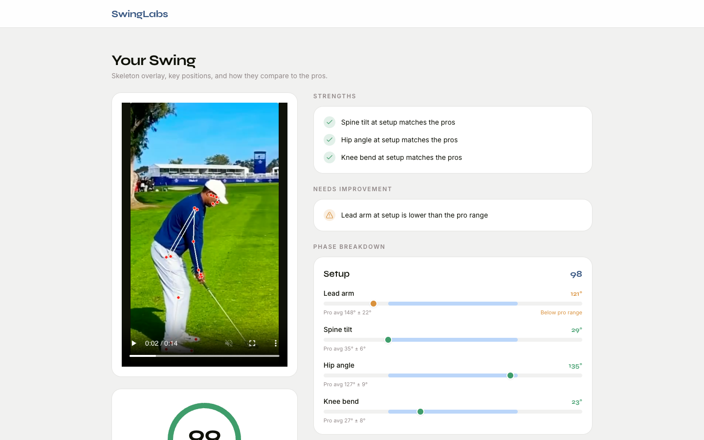
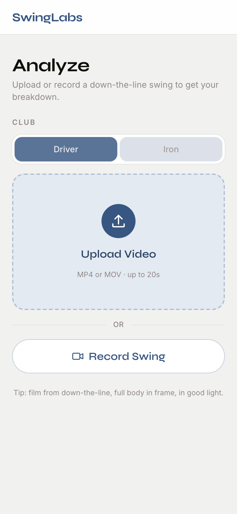

# Golf Swing Analyzer (SwingLabs)

A computer vision app that analyzes golf swing videos using pose estimation and compares your key positions to pro golfers.

**Live app:** _coming soon_ · **API:** _coming soon_

| Desktop | Mobile |
| --- | --- |
|  |  |

## Features

- [x] Upload or record a golf swing video (phones open the camera)
- [x] Detect body landmarks using pose estimation (MediaPipe)
- [x] Draw skeleton overlay on the video
- [x] Calculate body and arm angles (lead arm, spine tilt, hip angle, knee bend)
- [x] Compare swing positions to pro swings (driver and iron benchmarks)
- [x] Give beginner-friendly feedback
- [ ] Accounts and swing history (screens exist on mock data, not part of v1)

## How it works

1. You upload a swing video and pick driver or iron.
2. The backend runs MediaPipe Pose on every frame, finds setup, top of backswing, and impact from the lead wrist's path, and measures the angles at each.
3. Each angle is compared to the pro average for that club (in range = within 1.5 standard deviations, at least ±5°) and scored.
4. The results page shows the skeleton overlay video, an overall score, strengths, things to work on, and a phase-by-phase breakdown.

Film from down-the-line with your full body in frame. Videos are limited to 20 seconds / 100 MB, and the overlay video is deleted after an hour.

## Tech Stack

- Frontend: Next.js, React, Tailwind (deployed on Vercel)
- Backend: Python, FastAPI (deployed as a Docker container on Hugging Face Spaces)
- Computer Vision: OpenCV, MediaPipe

## Run locally

Requires Python 3.9–3.12 and Node 20+.

**Backend** (http://localhost:8000, interactive docs at `/docs`):

```bash
python3 -m venv .venv
source .venv/bin/activate
pip install -r backend/requirements.txt
cd backend
uvicorn api:app --reload
```

**Frontend** (http://localhost:3000), in a second terminal:

```bash
cd frontend
npm install
npm run dev
```

The frontend calls `http://localhost:8000` by default. To use another backend, set `NEXT_PUBLIC_API_URL` in `frontend/.env.local`.

## Deploy

**Backend → Hugging Face Spaces (free, 2 CPU / 16 GB RAM).**
Create a new Space with the **Docker** SDK, then upload the contents of `backend/` (it already has the `Dockerfile` and the Space config in `backend/README.md`). In the Space settings, add the variable `ALLOWED_ORIGINS` = your Vercel URL (e.g. `https://swinglabs.vercel.app`). The API will be at `https://<username>-<space-name>.hf.space`. Free Spaces sleep after ~48 hours without traffic; the first request after that takes about a minute.

**Frontend → Vercel (free).**
Import the GitHub repo in Vercel, set **Root Directory** to `frontend`, and add the environment variable `NEXT_PUBLIC_API_URL` = your Space URL. It's baked in at build time, so redeploy after changing it.

## Rebuild the pro benchmark

Pro videos go in `sample_videos/` at the repo root (git-ignored), with `driver` or `iron` in the filename. See [PIPELINE_README.md](PIPELINE_README.md) for details.

```bash
source .venv/bin/activate
cd backend
python -c "from analyze_swing_pipeline import process_all_videos; process_all_videos('../sample_videos')"
python compute_statistics.py
```
